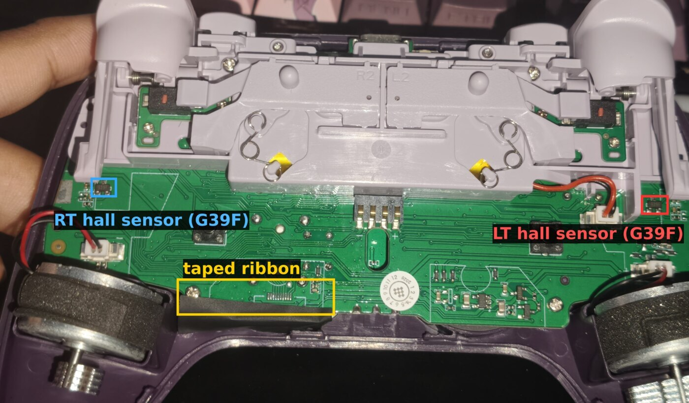
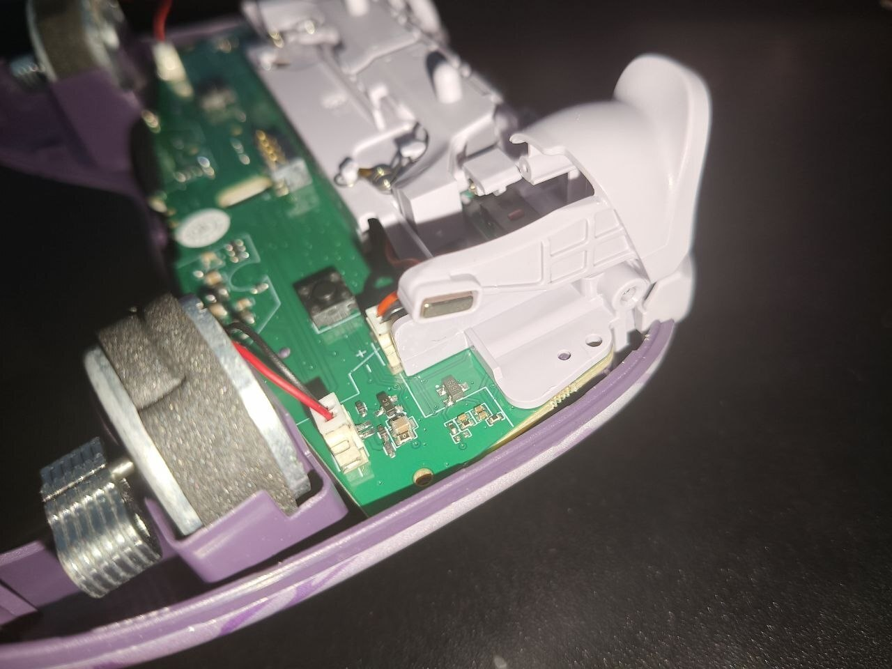
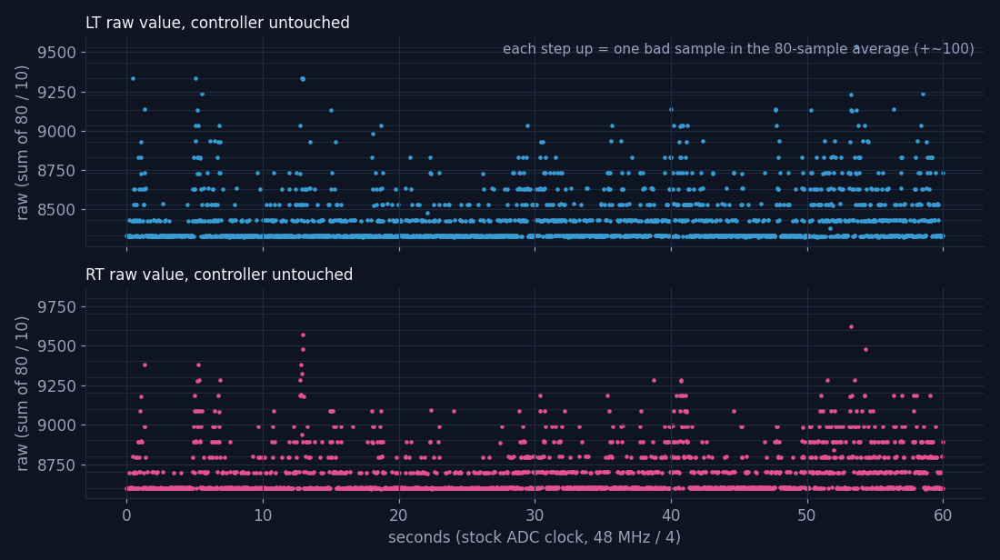
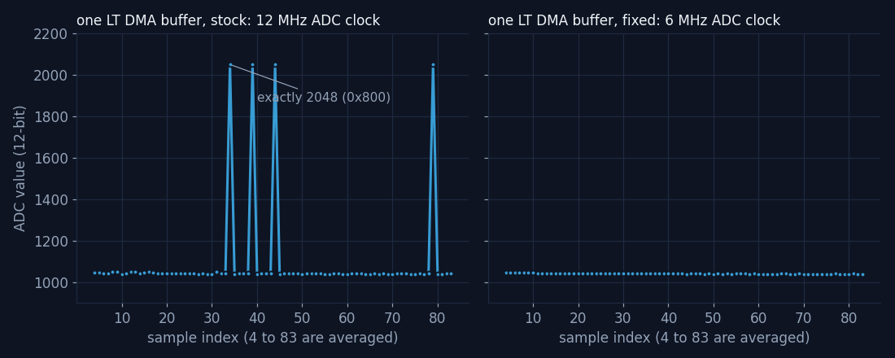

<!-- banner:start -->
> [!CAUTION]
> **This entire document was written by Claude Opus 5.5 on xHigh reasoning.** I did not check
> every byte of it, and I am **not responsible for anything in here that turns out to be wrong.**
> Some of it probably is. Flash something because a README told you to, turn your controller into
> a very expensive paperweight, and that is on you. Not me, not Claude, you.
>
> Read the code yourself. Check every address and every command before you run it. Better yet,
> do the shi yourself and use this as a map, not a manual. **You have been warned.**

**Same thing, but shorter and just looks nicer i guess? → [vivlos.dev/8bitdo-u2](https://vivlos.dev/8bitdo-u2/)**
<!-- banner:end -->


# 8BitDo Ultimate 2 Wireless: the phantom trigger was the ADC clock

My 8BitDo Ultimate 2 Wireless started pressing its own triggers. LT, and later RT, sat at 20 to 70%
with nothing touching them. Everyone's first guess (mine too) was a dying hall sensor. It wasn't.
The co-processor that reads the triggers runs its ADC faster than this particular chip can handle,
and every now and then a conversion comes out as exactly 2048. Halving the ADC clock in the
firmware fixed it completely.

This is everything learned on the way: the wrong turns, how 8BitDo's updater and bootloader work,
how to get raw sensor data out of a stock controller without soldering anything, the proof, and
the 8-byte patch. Every number here was measured on the controller or read from the firmware.
Things that were not verified say so.

Written 2026-10-22. Firmware analysed: 8BitDo's official Ultimate 2 Wireless update `1.10`
(145,436 bytes, SHA-256 `968edee5…f5eb87`), plus `1.09` for comparison.

> **This only matters if your controller has the same fault.** If your triggers are fine, there
> is nothing to fix. The patch has been tested on exactly one controller.

## -2. Changelog

Newest first. Small wording fixes are not listed.

**2026-10-22**

* First version.

## -1. What?

Find out why the triggers of one Ultimate 2 Wireless press themselves, and fix it if it can be
fixed. It could: it's a firmware setting, not broken hardware.

## 0. How to flash the fix

Linux only as written (the tools talk to `/dev/hidraw*` directly). You need Python 3 and, to
build the patch, `llvm-mc` and `llvm-objcopy` (`nix-shell -p llvm python3` on NixOS).

**0.1 Get the official files.** 8BitDo's firmware list is public:

```
curl -s -X POST https://support.8bitdo.com/restapi/link/v1/client/firmware/select \
  -H 'Content-Type: application/json' -d '{"firmware_type":94,"beta":1}'
```

Download the `fileURL` of `1.09` and `1.10` from the reply. Check them (the reply's `md5` field
is the same for both versions, so don't trust it):

| File | SHA-256 |
| :--- | :--- |
| 1.09 | `f754df15d0a3fde833f231c7d9d585490e22adfe9145a8dc1b7c85ab5515cbc1` |
| 1.10 | `968edee528c23d56e2059288f90c109fa5135f060de5b403e72d0b6c50f5eb87` |

**0.2 Build the patched 1.10.**

```
python3 tools/patch_ch32.py u2w_1.10.dat u2w_1.10_adcfix.dat --adcdiv 8 --adc-only
sha256sum u2w_1.10_adcfix.dat
# c5e5d60c3929d5a0701c5dbd91736bc77fc817fcf91f82146f286263d5962833
```

If the hash differs, stop.

**0.3 Find the controller's two HID nodes.** Plug it in with a USB cable. The *vendor* node is the
one whose report descriptor contains usage page `0xff7a`:

```
for h in /sys/class/hidraw/hidraw*; do
  od -An -tx1 -v $h/device/report_descriptor | tr -d '\n' | grep -q '06 7a ff' && basename $h
done
```

**0.4 Flash 1.09, then the patch.** The bootloader only re-flashes the co-processor when its
version number changes (5.5), and the patch keeps 1.10's number. So go through 1.09 first:

```
python3 tools/bootflash.py /dev/hidrawV jump            # V = vendor node from 0.3
# the controller re-enumerates as 2dc8:3208 "8BitDo Boot"; find its hidraw (B):
grep -l 'HID_NAME=8BitDo 8BitDo Boot' /sys/class/hidraw/*/device/uevent
python3 tools/bootflash.py /dev/hidrawB flash u2w_1.09.dat
# boots into 1.09. Repeat 0.3, then:
python3 tools/bootflash.py /dev/hidrawV jump
python3 tools/bootflash.py /dev/hidrawB flash u2w_1.10_adcfix.dat
```

`flash` checks the PID, erases, writes, reads everything back and only then restarts the
controller. It refuses to touch anything below `0x5000`, where the bootloader lives.

**0.5 Going back to stock.** Same thing with the official files: `1.09`, then `1.10`. Flashing
stock `1.10` straight over the patch keeps the patched co-processor, because the version
numbers match.

**0.6 If it ends up stuck in "8BitDo Boot".** Nothing is broken: the bootloader is untouched.
Flash any official file with `bootflash.py ... flash`, or just `bootflash.py /dev/hidrawB reset`
if the last write completed. The official web updater can also leave it there, see 5.3.

## Contents

1. [The controller](#1-the-controller)
2. [The symptom](#2-the-symptom)
3. [What it wasn't](#3-what-it-wasnt)
4. [Two chips in one update file](#4-two-chips-in-one-update-file)
5. [The update path and the bootloader](#5-the-update-path-and-the-bootloader)
6. [How a trigger gets read](#6-how-a-trigger-gets-read)
7. [Root cause: the ADC is clocked too fast](#7-root-cause-the-adc-is-clocked-too-fast)
8. [The fix](#8-the-fix)
9. [The patches that came before the fix](#9-the-patches-that-came-before-the-fix)
10. [Corrections and open questions](#10-corrections-and-open-questions)
11. [Reference](#11-reference)


## 1. The controller

| | |
| :--- | :--- |
| Controller | 8BitDo Ultimate 2 Wireless (2.4 GHz), the Evernight edition. It runs the regular Ultimate 2 Wireless firmware |
| Updater IDs | `firmware_type` 94, product ID `0x6012` |
| USB, normal | `2dc8:310b` "8BitDo Ultimate 2 Wireless Controller for PC" |
| USB, bootloader | `2dc8:3208` "8BitDo Boot" |
| Firmware on it | 1.10 (2026-05-13). 8BitDo's server only offers 1.09 and 1.10 |
| Triggers | hall effect: a magnet in the tip of each trigger arm, a 3-pin SOT-23 sensor marked `G39F` on the back board under each tip |

Not to be confused with the Ultimate 2 **Bluetooth** (`firmware_type` 97): different hardware,
encrypted firmware, nothing here applies to it.



This is the back of the controller, so LT is on the right of the photo (the trigger bracket says
`L2` on that side). Each `G39F` sits right under its trigger's magnet. There are no wires to the
sensor itself: the magnet moves closer, the voltage on the sensor's output pin changes. `G39F`
probably is a GoChip GH39FKSW linear hall sensor (same package and name fragment), not confirmed.



## 2. The symptom

With nothing touching it, 8BitDo's Ultimate Software showed LT at 28 to 56% and jumping around.
RT was fine at first and started doing the same a day later. Anything above `0x4D` (77 of 255,
about 30%) also sets the digital LT/RT button bits in the report (4.2), so games saw real trigger
presses. The owner remembered it starting after a firmware update.

It comes and goes. Some captures, all with the controller lying on the desk:

| Firmware | Length | LT | RT |
| :--- | :--- | :--- | :--- |
| 1.10 | 5 s | 0 to 191, 96 events | 0 to 69, 8 events |
| 1.10, right after flashing it | 30 s | 0 to 137, 5,658 events | quiet |
| 1.09 | 30 s, quiet phase | 0, no events | 0, no events |
| 1.09 | 30 s, a bit later | 0 to 179, 21,017 events | 0 to 83, 66 events |

"Events" are value changes seen by Linux (evdev, [`tools/live.py`](tools/live.py)), so they also say how busy it
was. Values are the report's 0 to 255.

## 3. What it wasn't

Most of the time went into things that turned out to be wrong. They're kept here because each
one looked convincing at the time, and two of them would have ended the investigation early.

### 3.1 The bumpers

The first description was "LB/RB glitching". The main chip's button code (4.2) scans a 4×6 key
matrix every 1 ms and reports each key from a single sample, with no debounce, so a bouncy
bumper switch would pass straight through. All true, and all about the wrong input: the video
showed the analog LT, not a bumper.

### 3.2 "1.10 broke it"

Flashing 1.09 gave 0 events in 5 s and again in 30 s. Back on 1.10: 5,658 events in 30 s.
That looked like proof, and 1.10's co-processor changes are almost all lighting code, so the
story became "the new RGB code disturbs the analog readings". Then 1.09 drifted again: 21,017
events in 30 s. The drift comes in phases, and short A/B tests happily land in a quiet one.
Both versions set the ADC clock the same way (7.2), so the version never mattered.

### 3.3 Calibration

8BitDo's software can recalibrate the triggers, and the same commands work over raw HID
(11.1): `81 05 00 3a 00` resets the trigger calibration, `81 05 00 3a 01` saves the newly learned
range. Both were acknowledged. 30 s untouched afterwards: LT 0 to 139 with 2,271 events. No change.

### 3.4 The lighting

Since 1.10 mostly changed RGB code, the lighting was switched off over HID (`81 04 40 00 06`,
11.1). 60 s before vs after: LT 23,900 → 8,800 events, RT 30,100 → 23,800. Still drifting.

### 3.5 Hall sensors, magnets, the ribbon

Before opening it, a flex test: pressing the left grip pegged LT at 255, pressing the middle of
the back woke both triggers, pressing the right side did nothing. That pointed at the left
sensor and the ribbon in the middle.

Opened up, the multimeter found the sensor pins: one at 0 V (GND), one at a steady 3.35 V (VCC,
doesn't move when the trigger is pulled), one that follows the trigger (OUT). The meter's other
readings on OUT were impossible (+7.68 V against GND, −17.67 V from VCC to OUT on a 3.35 V
part), so it couldn't say anything useful about OUT.

Poking around the bare board with a plastic stick (each sensor, the ribbon, the contacts in the
middle, the trigger motor plug) while logging: no spot made a difference. What the log did show:
the drift hit **both triggers at the same moments**, and the jumps landed on **the same few
values** over and over (LT 28, 52, 70, 83, 95, 133; RT 25, 48, 68, 80, 94). Two sensors failing
in lockstep is unlikely, so it had to be something they share. That was the first real clue, and
at that point the suspects were the sensors' shared power, ground, or the ribbon.

The flex test result is still not explained, see 10.2.

### 3.6 Filtering it away

Two firmware patches tried to hide the drift: a spike filter, then a rest deadzone (section 9).
Both helped and neither fixed it. They were useful anyway: they showed the output moving in fixed
steps, which is what led to looking at raw ADC values.


## 4. Two chips in one update file

### 4.1 The `.dat`

| Offset | Content |
| :--- | :--- |
| `0x00` | 28-byte header: version (`0x6e` = 1.10), load address `0x5000`, size `0x23800`, PID `0x6012`, a 32-bit field that didn't match any checksum tried, 0, 0 |
| `0x1c` | main chip image (Telink, `KNLT` at +8). Word +`0x18` = end of its code (`0x17a64` in 1.10), followed by a CRC32 |
| `0x1c + 0x17a68` | the co-processor's application, to the end of the file |

Offsets below are inside the image (header stripped) unless they're co-processor addresses.

### 4.2 Main chip: Telink

A Telink chip (TC32 instruction set) does USB, the 2.4 GHz radio, the buttons, remapping and
macros, and builds the reports. Buttons are a 4×6 matrix scanned every 1 ms. Analog trigger
values arrive from the co-processor over a UART, and anything above `0x4D` also sets the digital
LT/RT bits. Decompiled with Ghidra and the TC32 module from `trust1995/Ghidra_TELINK_TC32`.

### 4.3 Co-processor: WCH RISC-V

The rest of the file is a plain RISC-V application for a WCH microcontroller. It reads the
sticks and triggers, the gyro, drives the lighting and stores calibration. Most likely a
CH32X035: 48 MHz fixed clock, 20 KB RAM, and an ADC clock register that matches WCH's CH32X035
SDK (7.5). Inferred from the code, the chip marking was not read.

| 1.10 | |
| :--- | :--- |
| Load address | `0x3000` (its own 12 KB bootloader sits below) |
| RAM code | flash `0x3100`, `0x1a04` bytes, copied to `0x20000000` at boot. Far calls from there show up as `0xe000xxxx` when disassembled at the flash address |
| gp | `0x20002288` |
| Stack top | `0x20005000` (20 KB RAM) |
| Vector table | `mtvec = 0x3004`, vectored. Reserved slots 4 and 7 hold 8BitDo's length and version (5.5) |

### 4.4 1.09 vs 1.10

The main chip's code is identical except for the power-off routine. The co-processor changes
are lighting code (a new RGB type handler, extra logging) and one new UART command. Nothing
touches the ADC or the triggers, which fits 3.2.

## 5. The update path and the bootloader

### 5.1 The official updater

`web.8bitdo.com` is a WebHID page and works on Linux in Chromium and Brave, no driver needed.
It lists every version the server has (so 1.09 is selectable), and **Ctrl+click on the update
button opens a file picker for a local `.dat`**. Its protocol code is in
`p_connectDevice-*.js`; [`tools/bootflash.py`](tools/bootflash.py) is a reimplementation of the bootloader-mode part.

### 5.2 Bootloader protocol

In the bootloader the controller is `2dc8:3208` with one HID interface: 64-byte reports, no
report ID. Each request is `05, cmd u16, params u16, len u16, crc16 u16, total_len u32,
offset u32, data…` (little endian). The reply repeats the fields from byte 2; success is
reply cmd 0 with params equal to the command sent, reply data starts at byte 18.

| cmd | What | Notes |
| :--- | :--- | :--- |
| 8 | read PID | answers `0x6012` |
| 5 | read flash | 32 bytes at `offset` |
| 4 | erase | `total_len` bytes from `offset` |
| 3 | write | 46 bytes, `crc16` = CRC-16/MODBUS of the data |
| 7 | reset | no reply, boots the image |
| 195 | "read CRC" | returned values didn't match a CRC-16 of the data, not used |
| 196 | save | **never answers** (5.3) |

The image is written at `0x5000`. The bootloader lives at `0` to `0x5000`; the tools here refuse
to erase or write below `0x5000`.

### 5.3 Why the website says "update failed"

After writing, the website sends cmd 196 and waits for a reply that never comes. It reports
"update failed" and never sends the reset, so the controller stays in "8BitDo Boot". The image
was fine: all `0x23800` bytes read back identical to the official file, and a plain reset
(cmd 7) booted it. `bootflash.py` skips cmd 196.

### 5.4 Getting into the bootloader

From the running controller, on the vendor interface (usage page `0xff7a`), send report
`81 05 00 51 00`. The firmware writes `0x5a` into retained analog register `0x3c` and reboots,
and the bootloader sees the flag and stays. The website's own jump command (12) does nothing on
this model.

### 5.5 What the bootloader checks before booting

Read out the bootloader with cmd 5 (`0` to `0x5000`) and decompiled it with the same TC32 setup.
If the `0x3c` flag isn't set:

1. **Main image:** the Telink code ends with a standard CRC32; the byte-sum of everything
   before that CRC must equal the word right after it.
2. **Co-processor image:** length = u32 at co-processor offset `0x14`; the 32-bit byte-sum of
   the first `length` bytes must equal the u32 stored right after them. Otherwise it stays in
   the bootloader. This is what rejected the first patched file here: the new code sat past
   `length` and the sum was stale.
3. **Co-processor version:** it reads the version from the co-processor (its address
   `0x08003020`) and compares it with u32 at offset `0x20` of the image. **Only if they differ**
   does it re-flash the co-processor: erase 4 KB pages, write 256-byte chunks up to `length`,
   then send the stored sum for the co-processor's own bootloader to check.

Point 3 is why installing the patch goes through 1.09 first (0.4).

| | 1.09 | 1.10 |
| :--- | :--- | :--- |
| co-processor `length` | `0xbbdc` | `0xbc44` |
| stored sum | `0x004c9bc0` | `0x004cb5e5` |
| version word | `0x6d` | `0x6e` |

## 6. How a trigger gets read

All co-processor addresses, 1.10.

### 6.1 ADC and DMA

The ADC reads six inputs: four stick axes, LT and RT. One channel at a time: DMA collects **84
conversions** into a buffer, an interrupt copies it into that channel's array (six arrays of 84
values at `gp-836`) and starts the next channel. The ADC clock is set once at init (7.5).

### 6.2 Averaging

A loop sums samples **4 to 83** of each array (sample 0 still holds the previous channel) and
divides by 10, so the "raw" value is 8 × the mean of 80 conversions. For LT and RT that value
goes straight into the raw table at `gp-1796` (entries 4 and 5); the stick values get more
processing first.

### 6.3 Scaling

`scale(axis)` at `0x5920`: `(raw - min) * 1023 / (max - min)`, clamped to 0 to 1023, with min and
max from calibration. Then a 1024-entry response curve at `0xdec0` turns that into 0 to 255.
The curve is steep near zero (`curve[26] = 24`), so small values get amplified. The result goes
over the UART to the main chip and into the USB report.

The two calls that do this for LT and RT are in the RAM code at flash `0x3a06` and `0x3a12`.

### 6.4 What one bad sample does

If one of the 80 samples reads 2048 instead of 1041, the raw value goes up by
(2048 − 1041) / 10 ≈ **100**. This unit's calibrated trigger range is about 4,000 raw, so that's
26 of 1023 after scaling, and **24 of 255 in the report**: a phantom 9% press from one wrong
conversion out of 80. Two bad samples, 47. Three, 67. That's the ladder of repeating values
from 3.5 (the exact numbers shift a little with where each trigger rests).


## 7. Root cause: the ADC is clocked too fast

### 7.1 Getting raw values out without soldering

The firmware has no debug output for the ADC, and measuring the sensors with a multimeter went
nowhere (3.5). But there is one existing round trip from the PC into the co-processor and back:
`81 04 41 00` makes the main chip ask the co-processor for its lighting mode (UART command
`0x1b`), and the one-byte answer comes back to the PC in byte 18 of the reply.

So the diagnostic builds point the co-processor's call at `0x4862` (which fetches that byte) at
a small routine of their own, and the byte becomes a data stream. A frame starts with `FF`, the
data is split into 7-bit pieces so `FF` can't appear inside it. Polling as fast as USB allows
gives about 270 bytes per second:

* `--diag`: raw LT, RT and stick X from the raw table, 39 frames per second ([`tools/telem.py`](tools/telem.py))
* `--diag2`: a full copy of the LT and RT sample arrays, 84 + 84 values, about one every 1.2 s
  ([`tools/telem2.py`](tools/telem2.py))

Everything else keeps working while it runs.

### 7.2 Raw values: a lattice



60 s untouched at the stock clock ([`data/telem_raw_div4_60s.log`](data/telem_raw_div4_60s.log)). LT rests at 8330 and RT at
8602, and every excursion lands **exactly** 100 (LT) or about 97 (RT) above the last step:
8330, 8430, 8530, 8630… The stick, read the same way, mostly stayed within ±10 of 17930
(17788 to 18020 over the minute). Noise doesn't make steps of exactly 100.
Whole extra samples do: 100 raw is one sample being about 1,000 off (6.4).

### 7.3 The sample arrays: exactly 2048



72 snapshots at the stock clock ([`data/snap_div4_90s.log`](data/snap_div4_90s.log), [`tools/snapstats.py`](tools/snapstats.py)). Samples 4 to
83, the ones that get averaged:

| | LT | RT |
| :--- | :--- | :--- |
| Rest value | 1041 | 1075 |
| Spread of the normal samples | ±2 (std 2.1) | ±2 (std 1.5) |
| Bad samples | 122 of 5,760 (2.12%) | 94 of 5,760 (1.63%) |
| Snapshots with at least one | 31 of 72 | 28 of 72 |
| Bad values | 2048 ×113, 1023 ×8, 1052 ×1 | 2048 ×89, 1023 ×3, 1792 ×1, 1055 ×1 |

The bad samples sit at random positions in the array, and they are **exactly** `0x800` (2048) or
`0x3FF` (1023). A sensor or a noisy supply would give random wrong values. These are bit patterns.

### 7.4 Why exactly 2048

The ADC is a successive approximation type: it finds the value one bit at a time, most
significant first. "Is the input above half scale?" If yes, set bit 11, then ask about the
next half, and so on down to bit 0.

At 1041 the first answer should be no. If the comparator hasn't settled when it's asked and
says yes, bit 11 is set, and every later step correctly decides the input is below each new
threshold, so all the remaining bits come out 0: **`0x800`**. The same thing one step later
(bit 10 wrongly cleared) gives **`0x3FF`**. Wrong decisions on the top bits, where the
comparator needs the most time, are the classic sign of an ADC clocked faster than it can settle.

Why the triggers and not the sticks: a trigger at rest sits near 1040, far below 2048, so a
wrong top bit adds about 1,000. A centred stick sits around 2240, close to 2048, so the same
mistake costs much less, and the stick deadzone hides it.

### 7.5 The clock

The ADC init writes the clock setting once, into ADC register `CTLR3` (`0x40012450`, bits 0 to 8):

| | 1.09 | 1.10 |
| :--- | :--- | :--- |
| Code | `c.li a1,19` / `jal 0x9940` at `0x6ca6` | the same at `0x6cd6` |
| Value | `0x13` | `0x13` |

In WCH's CH32X035 SDK, `0x13` is `ADC_CLK_Div4`: 48 MHz / 4 = **12 MHz**. The SDK's divider
values follow `((N-1) >> 1) << 4 | (N-1)`, so /8 is `0x37`. Whether 12 MHz is inside the chip's
rated range was not checked: it's the value 8BitDo ships, and it fails on this one.

### 7.6 The test

Same diagnostic build, only the clock changed to /8 (6 MHz), 88 snapshots
([`data/snap_div8_90s.log`](data/snap_div8_90s.log)):

| | 12 MHz (stock) | 6 MHz |
| :--- | :--- | :--- |
| LT bad samples | 122 of 5,760 | **0 of 7,040** |
| RT bad samples | 94 of 5,760 | **0 of 7,040** |
| Snapshots with any | 31 and 28 of 72 | 0 of 88 |

## 8. The fix

### 8.1 What changes

Stock 1.10 plus the clock, nothing else:

| Where (co-processor) | Stock | Patched |
| :--- | :--- | :--- |
| `0x6cd6` | `c.li a1,19` / `jal 0x9940` (`cd 45 ef 20 90 46`) | `jal 0xec60` / `c.nop` |
| `0xec60` | zero padding | `li a1,0x37` / `j 0x9940` |
| length word (offset `0x14`) | `0xbc44` | `0xbc68` |
| byte-sum (after the length) | `0x004cb5e5` | recomputed |

The helper loads the /8 value and jumps into the original clock function, which returns to the
code right after `0x6cd6`. The length grows by the helper so the bootloader sums and installs
it (5.5). `tools/patch_ch32.py --adcdiv 8 --adc-only` builds it and checks the original bytes
first.

### 8.2 Result

| Test | Result |
| :--- | :--- |
| 5 min untouched ([`data/adcfix_untouched_300s.log`](data/adcfix_untouched_300s.log)) | **0 LT events, 0 RT events** (a separate check right after showed the stick still reporting, so the reader was alive) |
| Owner's pull test, 4.5 min ([`data/adcfix_user_pull_test.log`](data/adcfix_user_pull_test.log)) | 45 LT and 38 RT presses, all real: full pulls to 255 and partial ones (61 to 98). No spikes. 2.5 minutes in the middle with no events at all |
| Version | still reports 1.10 |

On stock firmware every capture showed drift within seconds.

### 8.3 What it costs

Each conversion takes twice as long. Estimated from the settings (not measured), one round over
all six inputs goes from about 0.7 ms to about 1.5 ms, so the analog values in each report are
on average well under 1 ms older. The USB report rate, the buttons and the gyro don't change.

## 9. The patches that came before the fix

All built by [`tools/patch_ch32.py`](tools/patch_ch32.py) and kept so the numbers can be checked.

### 9.1 Getting code into the co-processor

The co-processor image ends with about 340 bytes of zero padding after its initialised data
(`0xec44` to `0xed98`), enough for small routines. The two trigger calls at `0x3a06`/`0x3a12` and
the lighting-mode call at `0x4862` are `auipc`/`jalr` pairs and easy to point elsewhere. The early
builds also set bit `0x40` in the lighting-mode answer, as a marker that the patched code was
really running (with the 1.09 hop from 0.4, it was).

### 9.2 Spike filter (`T=32 N=24`)

A change of up to 32 (of 1023) passes at once; a bigger jump only counts after 24 calls in a
row. 60 s untouched: off zero 5.2% (LT) and 6.2% (RT) of the time, against 23 to 67% in short
stock captures. Better, but most of what was left climbed one step at a time, and each step
was "small".

### 9.3 Rest deadzone (`DZ=115`)

Scaled values under 115 read 0 and the rest is stretched back to 0 to 1023, in front of the
filter. The deadzone itself worked (the new steps showed up exactly where predicted), but the
next 60 s landed in a bad phase: off zero 21% and 25% of the time, mostly 5 to 8 steps up. A
deadzone big enough for the bad phases would have eaten about 30% of the trigger.

### 9.4 Diagnostic builds

`--diag` and `--diag2` (7.1). They also carry the 9.2/9.3 code; the raw values they report are
from before it.


## 10. Corrections and open questions

### 10.1 Corrections

Things said during the investigation that turned out wrong. Kept so nobody repeats them.

| Said | Actually |
| :--- | :--- |
| The bumpers glitch | It was the analog LT (3.1) |
| 1.10 introduced the drift | It comes in phases and is on both versions; 1.09 sets the same clock (3.2, 7.5) |
| The new lighting code disturbs the ADC | Lighting off changed nothing that matters (3.4) |
| Faulty left hall sensor, ribbon or magnet | Both triggers fail in lockstep with bit-pattern values; the sensors are fine (7.3) |
| Each step of the ladder is one ADC count, and the trigger range is only about 40 counts | Each step is one bad sample out of 80, about 100 raw. The range is about 4,000 raw (6.4) |
| The update file's co-processor part has no checksum | Length at `0x14`, byte-sum right after it, checked by the bootloader (5.5) |
| The website's "update failed" means the flash failed | The write completes, the bootloader just never answers the save command (5.3) |

### 10.2 Open questions

* **The flex test.** Before opening the controller, pressing the left grip pegged LT at 255 and
  pressing the middle of the back woke both triggers (3.5). Bad ADC samples don't explain a
  solid 255. Maybe flexing moved the trigger arm, maybe it landed in a bad phase. Not
  repeated with the fix.
* **Why only this unit.** The replacement controller, same firmware, doesn't drift. Probably a
  slower ADC on this particular chip. A guess.
* **Why it comes in phases.** Minutes of quiet, then bursts. Temperature or supply voltage are
  the obvious suspects; nothing was measured.
* **Other units.** Untested. If yours drifts the same way (steps of the same size on both
  triggers), the diagnostic builds in 7.1 can check it without opening anything.
* **The chip.** CH32X035 is inferred from the code (4.3).
* **The cost.** 8.3 is an estimate. Counting ADC rounds per second on stock and patched would
  settle it.

## 11. Reference

### 11.1 HID commands (running controller)

Output report `0x81` on the vendor interface (usage page `0xff7a`), 64 bytes including the
report ID. `tools/hidcmd.py /dev/hidrawN 81 ...` sends one and prints the replies.

| Send | Does | Reply |
| :--- | :--- | :--- |
| `81 05 00 21 01` | read version | `02 22 6e …` = 1.10 |
| `81 05 00 3a 00` | reset trigger calibration | `02 3b …` |
| `81 05 00 3a 01` | save trigger calibration | `02 3b …` |
| `81 05 00 36 00` / `01` | reset all / stick calibration | |
| `81 04 40 00 <mode>` | set lighting mode, saved | `02 04 04 00 40 …` |
| `81 04 41 00` | read lighting mode | byte 18 |
| `81 05 00 51 00` | reboot into the bootloader (5.4) | none, it disconnects |

Lighting modes: 0 none, 1 power-on, 2 dynamic (default), 3 hot wheel, 4 solid,
5 "dynamic mingmo", 6 off, 7 max.

### 11.2 Co-processor addresses (1.10)

| Address | What |
| :--- | :--- |
| `0x3a06`, `0x3a12` | calls `scale(4)` (LT) and `scale(5)` (RT), RAM code |
| `0x4862` | call that fetches the lighting mode for UART command `0x1b`, RAM code |
| `0x5920` | `scale(axis)`: raw to 0..1023 |
| `0x6cd6` | ADC clock setup (`0x13` = /4) |
| `0x9940` | writes the ADC clock register (`ADC + 0x50`) |
| `0xdec0` | response curve, 1024 bytes |
| `0xec44` to `0xed98` | zero padding (patch space) |
| `gp-836` | six arrays of 84 samples |
| `gp-1796` | raw table, u16 per axis (4 = LT, 5 = RT) |

### 11.3 Tools

| File | What |
| :--- | :--- |
| [`tools/bootflash.py`](tools/bootflash.py) | bootloader flasher: `jump`, `probe`, `flash`, `reset`. Never writes below `0x5000` |
| [`tools/patch_ch32.py`](tools/patch_ch32.py) | builds the fix and the earlier patches (8, 9) |
| [`tools/hidcmd.py`](tools/hidcmd.py) | sends one vendor report, prints replies |
| [`tools/live.py`](tools/live.py) | live LT/RT bars from evdev, logs every change |
| [`tools/telem.py`](tools/telem.py), [`tools/telem2.py`](tools/telem2.py) | read the diagnostic builds (7.1) |
| [`tools/snapstats.py`](tools/snapstats.py) | bad-sample statistics for `telem2.py` logs |
| [`tools/farcalls.py`](tools/farcalls.py) | resolves `auipc`/`jalr` far calls in a rizin listing, RAM code aware |
| [`tools/plots.py`](tools/plots.py) | the two charts |
| [`tools/build_readme.py`](tools/build_readme.py), [`tools/build_site_page.py`](tools/build_site_page.py) | this README and the vivlos.dev page |

### 11.4 Data

| File | What |
| :--- | :--- |
| [`data/snap_div4_90s.log`](data/snap_div4_90s.log), [`data/snap_div8_90s.log`](data/snap_div8_90s.log) | sample-array snapshots, 12 MHz and 6 MHz (7.3, 7.6) |
| [`data/telem_raw_div4_60s.log`](data/telem_raw_div4_60s.log), [`data/telem_raw_div4_probe.log`](data/telem_raw_div4_probe.log) | raw LT/RT/stick X, stock clock (7.2) |
| [`data/adcfix_untouched_300s.log`](data/adcfix_untouched_300s.log), [`data/adcfix_user_pull_test.log`](data/adcfix_user_pull_test.log) | the fix (8.2) |
| [`data/filter_v1_untouched_60s.log`](data/filter_v1_untouched_60s.log), [`data/filter_v2_deadzone_untouched_60s.log`](data/filter_v2_deadzone_untouched_60s.log) | 9.2, 9.3 |
| [`data/stock_110_untouched_5s.log`](data/stock_110_untouched_5s.log), [`data/stock_109_untouched_4s.log`](data/stock_109_untouched_4s.log) | short stock captures |
| [`data/stock_110_poke_test.log`](data/stock_110_poke_test.log) | the bare-board poke test (3.5) |

Log lines are `unix_time axis value` (evdev, 0..255), `unix_time LT RT LX` (raw) or
`unix_time` followed by 168 samples (snapshots).

